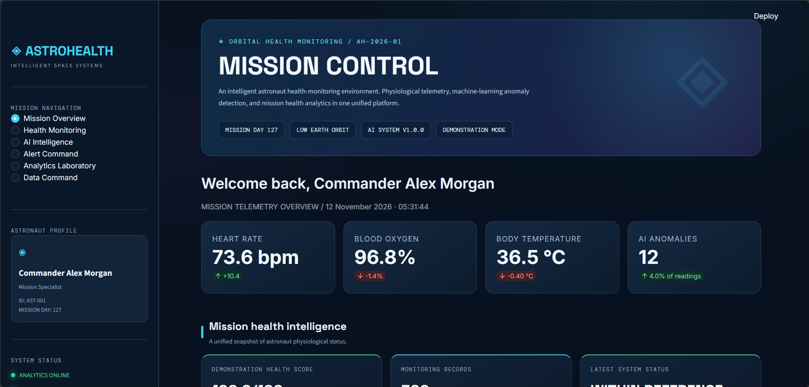
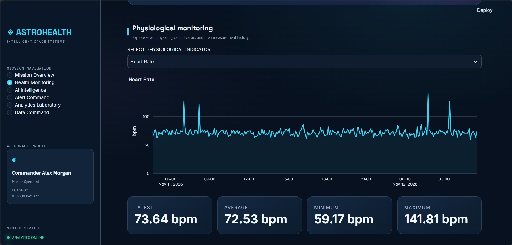
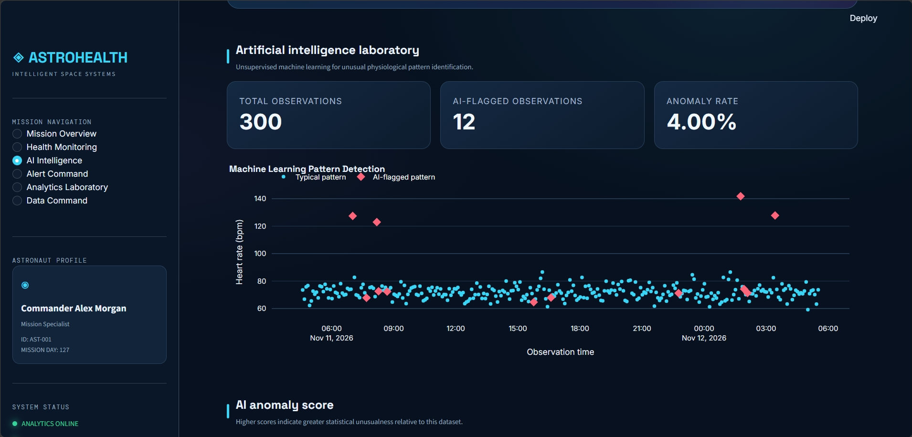
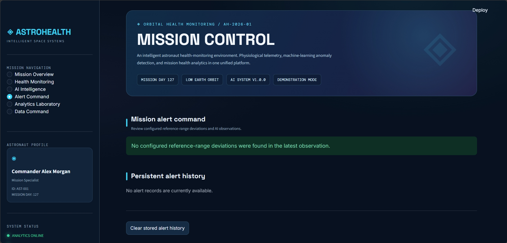
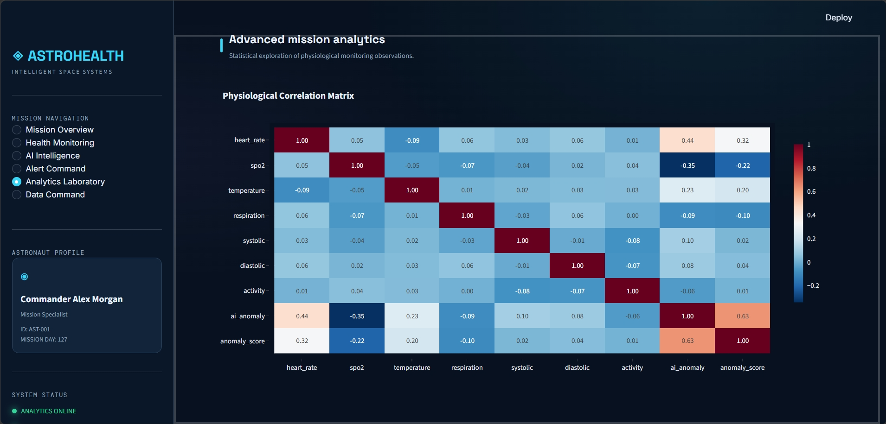
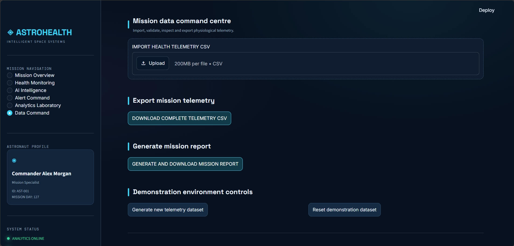

# 🛰️ AstroHealth AI
### Intelligent Astronaut Health Monitoring & Mission Control System

**An AI-powered health-monitoring platform designed to explore physiological telemetry, detect unusual health patterns, and support astronaut health monitoring during space missions.**

<p align="center">
  
  
  
  
</p>

---

## 🌌 Project Overview

Space exploration presents unique challenges to human health. Astronauts operating in microgravity, isolation, and confined environments require effective ways to monitor physiological changes and recognize unusual patterns.

**AstroHealth AI** explores how artificial intelligence and interactive data analytics can contribute to astronaut health monitoring.

The platform combines physiological telemetry, machine-learning-based anomaly detection, monitoring alerts, and interactive visualizations in a unified mission-control dashboard.

Developed as a software prototype in response to the **NASA Space Apps Challenge 2026** challenge:

*Create Health Monitoring Software for Astronauts on Space Missions.*

---

## 🖥️ Application Preview

AstroHealth AI features six integrated dashboard sections, each designed for a different aspect of astronaut health monitoring.

### 01 — Mission Overview

The central mission-control interface provides an overview of astronaut information, physiological measurements, monitoring statistics, and system status.



### 02 — Health Monitoring

Explore seven physiological indicators through interactive charts, historical measurements, and configured reference-range comparisons.



### 03 — AI Intelligence

The machine-learning module applies the Isolation Forest algorithm to identify statistically unusual physiological observations and display anomaly scores.



### 04 — Alert Command

A centralized alert interface for reviewing configured reference-range deviations, recommended verification actions, and persistent alert history.



### 05 — Analytics Laboratory

Explore physiological relationships through correlation heatmaps, statistical distributions, descriptive statistics, and experimental trend projections.



### 06 — Data Command

Import and validate CSV datasets, export physiological telemetry, generate mission reports, and manage demonstration data.



---

## ✨ Core Features

| Feature | Description |
|---|---|
| Mission Control Dashboard | Unified astronaut monitoring interface |
| Physiological Monitoring | Seven health-related indicators |
| AI Anomaly Detection | Unsupervised Isolation Forest model |
| Anomaly Scoring | Statistical unusualness analysis |
| Alert Management | Monitoring alerts and verification recommendations |
| Data Visualization | Interactive Plotly charts |
| Correlation Analysis | Physiological indicator heatmap |
| Trend Projection | Experimental linear trend analysis |
| CSV Integration | Upload, validate, and export datasets |
| Alert Database | SQLite-based persistent alert history |
| Mission Reports | Downloadable monitoring summaries |

## 🧠 Artificial Intelligence Methodology

AstroHealth AI uses **Isolation Forest**, an unsupervised machine-learning algorithm, to identify unusual patterns in physiological observations.

Unlike traditional supervised classification, Isolation Forest can identify statistical anomalies without requiring a labelled dataset for training.

### Processing Pipeline

```text
       PHYSIOLOGICAL TELEMETRY
                  |
                  ▼
          DATA VALIDATION
                  |
                  ▼
        FEATURE PREPARATION
                  |
                  ▼
         ISOLATION FOREST
                  |
                  ▼
        ANOMALY IDENTIFICATION
                  |
                  ▼
         ALERT GENERATION
                  |
                  ▼
       INTERACTIVE ANALYTICS
                  |
                  ▼
          MISSION CONTROL
```

### Monitored Indicators

1. Heart rate (bpm)
2. Blood oxygen saturation (%)
3. Body temperature (°C)
4. Respiration rate (breaths/min)
5. Systolic blood pressure (mmHg)
6. Diastolic blood pressure (mmHg)
7. Activity level (%)

The platform also calculates anomaly scores and displays unusual observations for further review.

## 🛠️ Technology Stack

| Technology | Application |
|---|---|
| Python | Core programming language |
| Streamlit | Interactive web dashboard |
| Pandas | Data processing and manipulation |
| NumPy | Numerical computation |
| Scikit-learn | Machine-learning anomaly detection |
| Plotly | Interactive data visualization |
| SQLite | Alert history and data persistence |

## 🏗️ Project Architecture

```text
AstroHealthAI/
│
├── app.py
├── config.py
├── requirements.txt
├── README.md
│
├── assets/
│   ├── mission-overview.png
│   ├── health-monitoring.png
│   ├── ai-intelligence.png
│   ├── alert-command.png
│   ├── analytics-laboratory.png
│   └── data-command.png
│
├── data/
│
├── modules/
│   ├── __init__.py
│   ├── data_engine.py
│   ├── health_analyzer.py
│   ├── anomaly_detector.py
│   ├── recommendations.py
│   └── database.py
│
└── .streamlit/
    └── config.toml
```

## 🚀 Installation and Local Setup

Follow these instructions to run AstroHealth AI on your computer.

### 1. Clone the repository

```bash
git clone https://github.com/YOUR_USERNAME/AstroHealth-AI.git
cd AstroHealth-AI
```

### 2. Create a virtual environment

```bash
python -m venv .venv
```

### 3. Activate the environment

For Windows PowerShell:

```powershell
.venv\Scripts\Activate.ps1
```

### 4. Install the dependencies

```bash
pip install -r requirements.txt
```

### 5. Launch the application

```bash
python -m streamlit run app.py
```

Open the local URL displayed in your terminal.

## 📊 Data and Demonstration Environment

The current prototype generates synthetic physiological telemetry for demonstration and testing.

Users can also upload their own CSV datasets, provided they contain the required columns:

```text
timestamp
heart_rate
spo2
temperature
respiration
systolic
diastolic
activity
```

The imported observations are validated and processed before being displayed in the dashboard.

## 🔬 Innovation and Potential Impact

AstroHealth AI explores the potential of combining machine learning and interactive monitoring in a spaceflight health-monitoring environment.

Its main contribution is the integration of several capabilities into one application:

- Physiological data visualization.
- Unsupervised anomaly identification.
- Monitoring alerts and verification recommendations.
- Statistical analysis of physiological observations.
- Data import and report generation.

The concept could be extended through validated astronaut health datasets, personalized physiological baselines, and integration with appropriate spaceflight monitoring systems.

## 🔭 Future Development

Potential future improvements include:

- Integration with relevant real-world astronaut health datasets.
- More advanced personalized anomaly detection.
- Improved anomaly explanations and alert prioritization.
- Offline-first operation for limited-connectivity environments.
- Additional environmental and behavioral monitoring.
- Validation with medical and aerospace domain experts.

## ⚠️ Important Disclaimer

AstroHealth AI is an educational and research prototype.

The default application uses synthetic demonstration data rather than actual NASA astronaut medical records or live mission telemetry.

Its reference ranges, demonstration health score, anomaly detection outputs, and experimental projections are not clinically validated. The application does not diagnose medical conditions and is not intended to replace professional medical assessment or established astronaut healthcare procedures.

## 🏆 NASA Space Apps Challenge 2026

**Challenge:** Create Health Monitoring Software for Astronauts on Space Missions.

Official website: https://www.spaceappschallenge.org/

AstroHealth AI demonstrates a potential software approach to physiological monitoring and unusual-pattern identification in the context of human space exploration.

## 👩‍💻 Developer

**Abeeha Zeeshan**

Project concept, software development, dashboard implementation, machine-learning integration, and technical documentation.

### Project Links

- **GitHub Repository:** https://github.com/ab9eha/AstroHealth_AI.git
- **Live Streamlit Application:** https://astrohealthai1.streamlit.app/
- **NASA Space Apps Challenge:** https://www.spaceappschallenge.org/

---

<p align="center">
  <b>ASTROHEALTH AI</b><br/>
  <i>Intelligent monitoring for the future of human space exploration.</i>
</p>